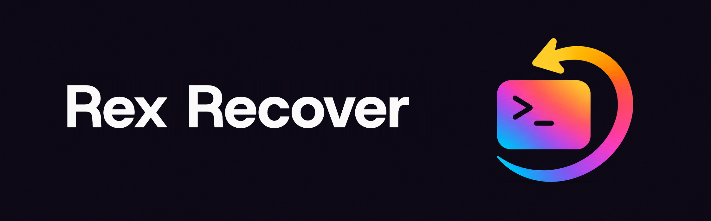

Get back to work after a Rex server restart without rebuilding your terminal
workflow by hand.

[Read the manual](docs/manual.md) for setup, configuration, and recovery limits.

## See it in action

https://github.com/user-attachments/assets/07f4cd47-7347-466f-a9b6-72ec8cec1763

## Why it exists

Rex brings back your panes and their layout. Rex Recover brings back the tools
you chose to keep there, from the folders and with the arguments you originally
used. That matters when a restart leaves several projects' worth of panes
sitting at shell prompts.

- **You choose what can run again.** Relaunching a command repeats its
  arguments and can repeat its effects. Nothing is monitored by default.
- **Launch details are recorded at the source.** Rex can see which process
  is running in the pane, but it doesn't expose the full arguments. Capturing the
  launch also preserves the original folder if the app changes directories.
- **The watcher runs outside Rex.** It needs to survive the restart to know
  what was last seen running. It waits for you to bring Rex back.

Recovery is based on the last observation. It can't recover unsaved work or the
state of a process in memory.

## Conversation recovery: requirements and tradeoffs

Opt in to reopen a saved conversation without replaying your original prompt.
Rex knows which app is running in a pane; only the app can identify the
conversation you were using.

- **Codex requires local mode and an approved `SessionStart` hook.** Run
  `codex --no-daemon`, or approve disabling daemon auto-start and stop any
  already-running daemon yourself before using plain `codex`. The shared
  daemon can give a hook the wrong pane's identity. The flag changes only
  that launch; the config setting also affects launches outside Rex. See
  [Codex setup and limits](docs/manual.md#resume-a-saved-codex-conversation-opt-in).
- **OpenCode requires the Rex Recover plugin.** The installer offers it
  separately. Its terminal part knows which conversation you selected; its
  server part verifies where that conversation is saved, so two panes in the
  same project can come back to different chats. See
  [OpenCode setup and compatibility](docs/manual.md#resume-a-saved-opencode-conversation-opt-in).
- **Claude Code uses `claude agents --json`.** Claude already reports which
  session belongs to a running process, so it needs no plugin or hook. This
  integration has only been tested with mocks. See
  [Claude Code setup and limits](docs/manual.md#resume-a-saved-claude-code-conversation-opt-in).

## Get started

On macOS or Linux, download and extract a
[release](https://github.com/nexxai/rex-recover/releases) or use this checkout.
Stop any manually running watcher first. In a terminal **outside Rex**, run:

```sh
sh install.sh
```

**Only monitor commands you are comfortable running again.** Recorded arguments
are stored locally and may contain secrets. The installer asks before setting up
automatic capture for zsh or bash, installing a user watcher service, or adding
an app integration. Open new Rex terminals and launch your chosen commands
once so they can be recorded.

Use `rex-recover apps` to change what you monitor. The [manual](docs/manual.md)
covers prerequisites, updates, troubleshooting, and setup for other shells.

## Uninstall

```sh
~/.local/bin/rex-recover-uninstall
```

Uninstall removes the managed OpenCode plugin and leaves your other plugins
alone. If you chose to change Codex's daemon auto-start setting, it explains
how to undo it. See [what uninstall keeps](docs/manual.md#interactive-installation-and-removal).

## Contribute

Contributions are welcome, especially integrations for shells beyond zsh and
bash. Every logic change must include a corresponding test. See
[CONTRIBUTING.md](CONTRIBUTING.md) and the [session-driver guide](drivers/README.md).

## License

[MIT](LICENSE).
